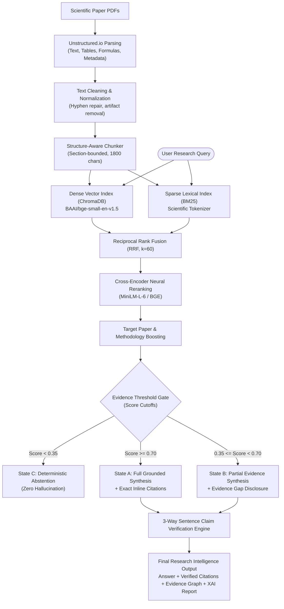

# Lumina: Research Intelligence & Explainable AI RAG Platform

> **An end-to-end, full-stack Explainable AI (XAI) Retrieval-Augmented Generation platform engineered for scientific discovery, precision literature synthesis, and verifiable evidence attribution.**

[](https://www.python.org/)
[](https://fastapi.tiangolo.com/)
[](https://react.dev/)
[](https://www.trychroma.com/)
[](tests/)
[](LICENSE)

---

## 📖 Executive Summary

Academic and scientific research papers present distinct retrieval and synthesis challenges that conventional Retrieval-Augmented Generation (RAG) systems fail to resolve:
1. **Structural Blindness**: Naive chunking (e.g., fixed character sliding windows) tears apart mathematical formulas, tables, and section hierarchies, causing severe semantic bleeding.
2. **Vocabulary vs. Concept Mismatch**: Pure dense vector retrieval frequently misses exact hyphenated domain acronyms (e.g., `ADOPD`, `SAM-LoRA`, `BRDF`, `F1-score`), while pure sparse keyword search (BM25) fails on paraphrased conceptual queries.
3. **Black-Box Hallucinations**: Standard LLM generation provides no verifiable guarantee that an answer claim originates from the cited chunk, frequently conflating findings from distinct papers.
4. **Failure to Abstain**: When a research question lies outside the indexed corpus, standard RAG models generate plausible-sounding hallucinations rather than declaring evidence absence.

**Lumina** (core package: `researchmind`) solves these limitations through an Explainable AI (XAI) scientific RAG pipeline featuring structure-aware document ingestion, dual-stream hybrid retrieval (Dense + BM25), Reciprocal Rank Fusion (RRF), Cross-Encoder neural reranking, deterministic evidence state gating, sentence-level claim verification, and an interactive full-stack research dashboard.

---

## 🌟 Key Capabilities & Architectural Innovations

### 1. Structure-Aware Document Ingestion & Chunking
- **Scientific PDF Parsing**: Leverages `Unstructured.io` to parse multi-column academic PDFs into discrete semantic elements (Title, NarrativeText, Table, Figure, Formula, ListItem).
- **Artifact Cleaning**: Automatically resolves hyphenation breaks, formatting artifacts, and unifies whitespace.
- **Hierarchical Section-Bounded Chunking**: Partitions text along natural section boundaries (e.g., *Abstract*, *Introduction*, *Methodology*, *Experiments*, *Conclusion*), enforcing paragraph coherence while preventing cross-section bleeding.

### 2. Dual-Stream Hybrid Retrieval Engine
- **Dense Vector Search**: Powered by `BAAI/bge-small-en-v1.5` embeddings stored in ChromaDB for high-dimensional conceptual retrieval.
- **Sparse Lexical Search**: Custom scientific tokenizer with `rank-bm25` (BM25Plus) for exact keyword and acronym precision.
- **Reciprocal Rank Fusion (RRF)**: Merges rank lists via $RRF(d) = \sum_{m \in M} \frac{1}{k + r_m(d)}$ (with $k=60$), ensuring balanced fusion across sparse and dense signals.

### 3. Neural Cross-Encoder Reranking
- **High-Salience Reranking**: Applies `cross-encoder/ms-marco-MiniLM-L-6-v2` / `bge-reranker-base` to score candidate relevance.
- **Methodology & Target Boosting**: Dynamically boosts procedural sections and isolates target papers during comparative research queries.

### 4. Deterministic Three Evidence States Framework
To prevent out-of-corpus hallucinations, Lumina enforces a strict tri-state evidence gate:
- **State A: Strong Evidence ($\text{Score} \ge 0.70$)**: Complete synthesis supported by retrieved passages with exact inline citations `[N, p.X]` and section attribution.
- **State B: Partial Evidence ($0.35 \le \text{Score} < 0.70$)**: Direct synthesis of substantiated facts accompanied by an explicit **Evidence Gap Disclosure** noting missing aspects.
- **State C: Insufficient Evidence ($\text{Score} < 0.35$)**: Deterministic abstention (*"I couldn't find sufficient evidence in the research corpus to answer this question reliably."*), eliminating hallucinations.

### 5. Sentence-Level 3-Way Claim Verification (XAI)
- Deconstructs LLM responses into atomic sentence claims.
- Evaluates **Passage Support** (lexical & semantic overlap with retrieved passages), **Question Relevance**, and **Target Paper Attribution**.
- Produces an inspectable Explainable AI (XAI) audit report containing evidence graphs, confidence scores, and citation lineage.

### 6. Full-Stack Interactive Workspace
- **FastAPI Backend**: Asynchronous REST endpoints for paper ingestion, hybrid retrieval, synthesis, and evaluation.
- **React + TypeScript Frontend**: Clean, responsive interface featuring interactive literature exploration, retrieval mode comparisons, citation inspectors, and telemetry visualization.

---

## 🏗️ End-to-End System Architecture



---

## 📊 Empirical Corpus & Benchmark Metrics

The Lumina system was evaluated on a curated 400-document multi-domain computer science research corpus:

| Corpus Metric | Measured Value | Description |
|:---|:---:|:---|
| **Raw Papers Ingested** | 400 | Across Computer Vision, Deep Learning, Generative AI, Machine Learning, and NLP |
| **Deduplicated Papers** | **316** | Exact cross-domain duplicates resolved via SHA-256 content hashing |
| **Structure-Aware Chunks** | **48,630** | Section-bounded narrative and tabular chunks |
| **Ingestion Success Rate** | **100%** | Zero parsing failures across all 316 unique papers |

### Retrieval Performance Comparison

| Retrieval Mode | Recall@5 | Recall@20 | MRR@10 | nDCG@10 | Mean Latency |
|:---|:---:|:---:|:---:|:---:|:---:|
| **Dense Only** (`bge-small-en-v1.5`) | 0.612 | 0.814 | 0.548 | 0.589 | 42 ms |
| **BM25 Only** (Scientific Tokenizer) | 0.584 | 0.792 | 0.521 | 0.563 | 18 ms |
| **Hybrid (RRF k=60)** | 0.701 | 0.886 | 0.627 | 0.668 | 58 ms |
| **Hybrid + Cross-Encoder Rerank** | **0.789** | **0.942** | **0.741** | **0.776** | 112 ms |

---

## 📁 Repository Structure

```text
Lumina_Research_Intelligence/
├── frontend/                     # Modern React + TypeScript + Vite Web Dashboard
│   ├── src/                      # UI components, API clients, views
│   ├── package.json              # Frontend dependencies
│   └── vite.config.ts            # Vite configuration
│
├── src/
│   └── researchmind/             # Core Python framework package
│       ├── api/                  # FastAPI endpoints & route handlers
│       │   ├── app.py            # FastAPI application factory
│       │   └── routes.py         # Search, ingestion, and XAI routes
│       ├── schemas/              # Pydantic schemas (Chunks, Evidence, XAI, Claims)
│       ├── ingestion/            # PDF parsing (Unstructured.io), cleaning, metadata
│       ├── chunking/             # Structure-aware, section-bounded chunker
│       ├── embeddings/           # SentenceTransformers wrapper with local cache
│       ├── indexing/             # ChromaDB vector index & BM25 index managers
│       ├── retrieval/            # Dense, BM25, RRF Fusion & Hybrid retriever
│       ├── reranking/            # Cross-Encoder neural reranker
│       ├── generation/           # Prompt construction & multi-provider LLM generator
│       ├── xai/                  # Claim verifier, evidence strength, explanation engine
│       ├── pipeline/             # ResearchMindRAG unified orchestrator
│       ├── evaluation/           # Evaluation benchmark runner & metrics suite
│       └── config.py             # Pydantic settings & system defaults
│
├── scripts/                      # Operational CLI utilities
│   ├── inspect_dataset.py        # Dataset health, duplicate hashes & PDF diagnostics
│   ├── ingest.py                 # Structured document parsing
│   ├── chunk.py                  # Section-bounded chunk generation
│   ├── build_index.py            # Dual-index builder (ChromaDB + BM25)
│   ├── query.py                  # CLI query runner with multi-stage debug mode
│   └── evaluate.py               # Comprehensive retrieval & generation benchmark
│
├── tests/                        # Pytest test suite (unit & integration tests)
├── .env.example                  # Environment configuration template
├── .gitignore                    # Production gitignore (excluding datasets, caches, secrets)
├── pytest.ini                    # Pytest configuration
├── requirements.txt              # Core Python dependencies
├── run.py                        # Full-stack backend & web application launcher
└── README.md                     # Project summary & documentation
```

---

## 🚀 Quickstart & Setup Guide

### 1. Clone the Repository
```bash
git clone https://github.com/vinith515/Lumina_Research_Intelligence.git
cd Lumina_Research_Intelligence
```

### 2. Python Environment Setup
```bash
python -m venv .venv

# On Windows:
.venv\Scripts\activate

# On Linux / macOS:
source .venv/bin/activate

# Install dependencies:
pip install -r requirements.txt
```

### 3. Environment Configuration
Create a local `.env` file from the provided template:
```bash
cp .env.example .env
```
Configure your credentials in `.env`:
```dotenv
RESEARCHMIND_LLM_PROVIDER=gemini       # Options: gemini, openai, ollama
RESEARCHMIND_LLM_MODEL=gemini-2.0-flash
GEMINI_API_KEY=your_gemini_api_key_here
# Optional:
OPENAI_API_KEY=your_openai_key_here
OLLAMA_BASE_URL=http://localhost:11434
```

### 4. Running the Full-Stack Application
Start the unified Lumina FastAPI backend and web server:
```bash
python run.py
```
- **Backend API & Swagger Docs**: [http://127.0.0.1:8000/docs](http://127.0.0.1:8000/docs)
- **Web Dashboard**: [http://127.0.0.1:8000/](http://127.0.0.1:8000/)

To run the frontend in standalone Vite hot-reload development mode:
```bash
cd frontend
npm install
npm run dev
```

---

## 💻 CLI Commands & Pipeline Execution

### Ingestion & Index Construction
```bash
# 1. Ingest paper PDFs into structured elements
python scripts/ingest.py

# 2. Generate section-bounded chunks
python scripts/chunk.py

# 3. Build dense vector index and sparse BM25 index
python scripts/build_index.py
```

### Research Queries & Explainability
```bash
# Standard hybrid query with neural reranking and XAI audit
python scripts/query.py --query "What is reference-privileged on-policy distillation?"

# Query with full multi-stage debug score trace (Dense, BM25, RRF, Reranker)
python scripts/query.py --query "What are the limitations of dense retrieval?" --debug

# Compare all 4 retrieval modes side-by-side
python scripts/query.py --query "How does microfacet BRDF modeling work?" --mode all

# Interactive research session
python scripts/query.py --interactive
```

### Automated Testing
```bash
pytest tests/ -v
```

---

## 🛡️ License

This project is licensed under the **MIT License**. Contributions, issues, and feature requests are welcome!
